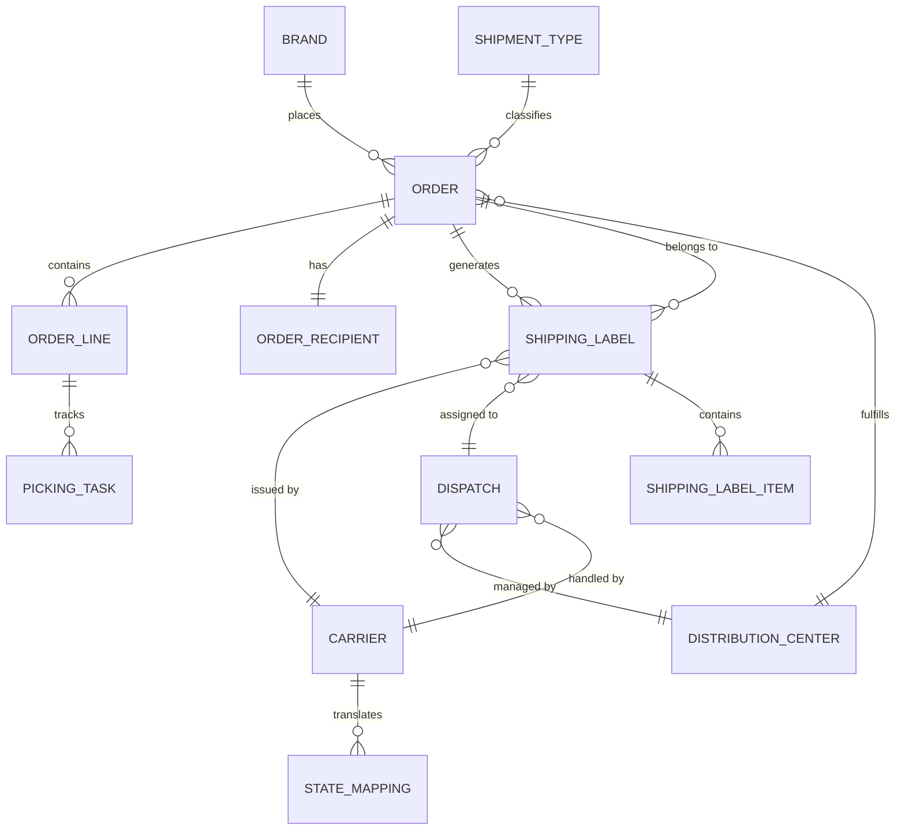

# Backend Stack

The Control Tower backend is built with Python and FastAPI (ADR-0001), using async SQLAlchemy for database access and Alembic for schema migrations. PostgreSQL is the primary operational database.

## Technology stack

| Component | Technology | Purpose |
|---|---|---|
| **API framework** | FastAPI | Async HTTP API with automatic OpenAPI documentation |
| **ORM** | SQLAlchemy 2.x (async) | Declarative models with type annotations |
| **Migrations** | Alembic | Versioned schema migrations, auto-generated from models |
| **Database** | PostgreSQL 16 | Transactional store for all operational data |
| **Message broker** | RabbitMQ 3.12 | AMQP message broker for asynchronous event ingestion |
| **Task queue** | Celery 5.3 | Distributed task processing for payload normalization |
| **Orchestration** | Apache Airflow 2.9 | TaskFlow API (@dag, @task) for polling and batch ingestion |
| **Containerization** | Docker + Docker Compose | Multi-stage production builds, automatic migration on start |
| **Package manager** | uv | Fast, deterministic dependency resolution |
| **Linting** | Ruff | Lint and format checking (100-char line length) |
| **Type checking** | mypy | Static type analysis |
| **Testing** | pytest + pytest-cov | Unit and integration tests (80% minimum coverage) |

## Application structure

```text
cargaexpress_control_tower/
├── backend/
│   ├── app/
│   │   ├── models/         # 12 SQLAlchemy ORM models
│   │   ├── repositories/   # Database access layer
│   │   ├── routers/        # FastAPI route handlers
│   │   ├── schemas/        # Pydantic request/response schemas
│   │   ├── services/       # Business logic layer
│   │   ├── tasks/          # Celery asynchronous tasks (webhooks & events)
│   │   ├── config.py       # Settings from environment variables
│   │   ├── database.py     # SQLAlchemy engine and session
│   │   ├── main.py         # FastAPI application factory
│   │   └── security.py     # API key and admin token validation
│   ├── alembic/
│   │   └── versions/       # Migration scripts
│   ├── tests/              # pytest test suite
│   ├── Dockerfile          # Multi-stage production image
│   └── pyproject.toml      # Dependencies and tool configuration
├── dags/                   # Apache Airflow 2.9 DAGs (TaskFlow API)
│   ├── dag_type_b_polling.py       # Polling Carrier B active tracking every 30m
│   ├── dag_type_c_ingestion.py     # Batch CSV ingestion Carrier C every 4h
│   ├── dag_distributed_validation.py # Validation and health check DAG
│   └── utils/
│       └── control_tower_client.py # Modular reusable HTTP client for DAGs
├── docs/api/
│   └── openapi.json        # Exported OpenAPI contract
├── scripts/
│   └── export_openapi.py   # Contract export utility
├── docker-compose.yml       # Backend + PostgreSQL
└── README.md
```

## Database models (12 tables)



| Model | Table | Key columns |
|---|---|---|
| `Brand` | `brands` | `brand_id`, `name` |
| `Carrier` | `carriers` | `carrier_id`, `name` |
| `DistributionCenter` | `distribution_centers` | `dc_id`, `name` |
| `ShipmentType` | `shipment_types` | `shipment_type_code`, `description` |
| `Order` | `orders` | `order_id`, `brand_id`, `dc_id`, `status`, `brand_order_ref` |
| `OrderLine` | `order_lines` | `order_line_id`, `order_id`, `sku`, `quantity` |
| `OrderRecipient` | `order_recipients` | `order_id` (PK + FK), `full_name`, `address_line`, `city` |
| `Dispatch` | `dispatches` | `dispatch_id`, `dc_id`, `carrier_id` |
| `ShippingLabel` | `shipping_labels` | `label_id`, `order_id`, `carrier_id`, `tracking_number`, `status` |
| `ShippingLabelItem` | `shipping_label_items` | `label_id`, `order_line_id`, `quantity` |
| `PickingTask` | `picking_tasks` | `picking_id`, `order_line_id`, `status` |
| `StateMapping` | `state_mapping` | `id`, `carrier_id`, `raw_status`, `canonical_status` |

## Key constraints

- `tracking_number` is **globally unique** across all carriers.
- `(brand_id, brand_order_ref)` is **unique per brand**.
- `(carrier_id, raw_status)` is **unique** in `state_mapping`.
- `canonical_status` has a `CHECK` constraint limiting values to the 8 canonical states.
- Indexes on `orders.brand_id`, `orders.status`, `shipping_labels.order_id`, `shipping_labels.carrier_id`.

## API endpoints

### Health

| Method | Path | Purpose |
|---|---|---|
| `GET` | `/api/v1/health` | Database connectivity check |
| `GET` | `/api/v1/ready` | Readiness probe (Docker healthcheck) |

### Orders (HU-13)

| Method | Path | Purpose |
|---|---|---|
| `POST` | `/api/v1/orders` | Create an order with lines and recipient |
| `GET` | `/api/v1/orders` | List orders with pagination |
| `GET` | `/api/v1/orders/{order_id}` | Get a single order |
| `PATCH` | `/api/v1/orders/{order_id}/status` | Update order status |

### Shipping Labels (HU-14)

| Method | Path | Purpose |
|---|---|---|
| `POST` | `/api/v1/orders/{id}/shipping-labels` | Register a new label for an order |
| `GET` | `/api/v1/orders/{id}/shipping-labels` | List labels of an order |

### Admin: State Mapping (HU-12)

| Method | Path | Purpose |
|---|---|---|
| `GET` | `/api/v1/admin/state-mappings` | List mappings (filter by carrier) |
| `GET` | `/api/v1/admin/state-mappings/resolve` | Resolve a raw status to canonical |
| `POST` | `/api/v1/admin/state-mappings` | Create a mapping |
| `PATCH` | `/api/v1/admin/state-mappings/{id}` | Modify a mapping |
| `DELETE` | `/api/v1/admin/state-mappings/{id}` | Delete a mapping |

### Admin: Carrier State Mapping (HU-15)

| Method | Path | Purpose |
|---|---|---|
| `GET` | `/api/v1/admin/carrier-state-mapping/{id}` | Get full carrier mapping |
| `PUT` | `/api/v1/admin/carrier-state-mapping/{id}` | Replace entire carrier mapping |

## Security

- **`X-API-Key`:** Brand-level access. The `BRAND_API_KEYS` configuration maps keys to brand IDs. The tenant is derived from the authenticated key, not from request headers.
- **`X-Admin-Token`:** Admin-level access for state mapping management. Set via `ADMIN_API_KEY` in `.env`; if empty, admin API responds `503`.
- In production, all secrets must be at least 32 characters and must not start with `change_me`.
- OpenAPI/Swagger docs are disabled in production.

## Migration history

| Revision | Change |
|---|---|
| Initial | Created all 11 base tables |
| `a3f1c9d27b45` | Created `state_mapping` table |
| `b7e24d51c8a9` | Added simulated carrier seed data |
| `c4a1209b7e6f` | Aligned column names, added CHECK constraint, transformed legacy statuses |
| `f6b2a9d14c83` (head) | Added uniqueness constraints and indexes for orders and labels |

Migrations run automatically on backend startup via `alembic upgrade head`.
