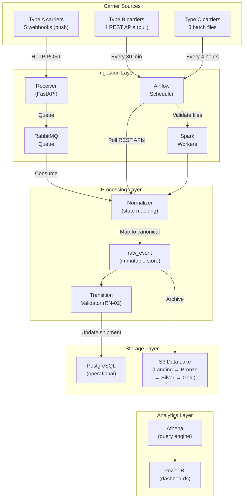

# Data Flow and Ingestion Pipeline

This page documents the end-to-end data flow from carrier events to the analytical layer. All three ingestion modalities converge into a single raw event store.

## End-to-end ingestion flow

## Three ingestion modalities (ADR-0008)

| Modality | Carriers | Mechanism | Schedule |
|---|---|---|---|
| **A — Push** | 5 Type A carriers | Webhooks received by a FastAPI receiver, queued in RabbitMQ | Real-time |
| **B — Pull** | 4 Type B carriers | An Airflow DAG polls their REST APIs | Every 30 minutes |
| **C — File** | 3 Type C carriers | An Airflow DAG validates and cleans CSV or Excel files | Every 4 hours |

All three end as a row in `raw_event` and are then normalized with the **same rules**.

## Processing pipeline

### 1. Receive raw event

The raw carrier event is received and stored **unchanged** in `raw_event` with:
- The original payload (exact bytes).
- A receiving timestamp.
- A **hash** for deduplication (unique constraint — ADR-0007).

### 2. Deduplicate

An identical repeated message (same hash) cannot be stored twice. A retried message that differs in any field produces a different hash and must be handled by the normalization step.

### 3. Normalize status

The `state_mapping` table translates each carrier's proprietary status code into one of the 8 canonical states. The mapping is:
- **Carrier-specific:** each carrier has its own set of raw-to-canonical translations.
- **Configurable:** mappings can be changed via the admin API without restarting the service.
- **Cached:** mappings are cached in memory for 300 seconds and invalidated on write.

If no mapping exists for a raw status, it is surfaced for operational review (HTTP `404` from the resolve endpoint), not silently mapped to a default.

### 4. Validate transitions (RN-02)

Before updating the shipment's canonical state, the transition validator checks:

- **Terminal state protection:** `DELIVERED`, `RETURNED`, and `LOST_OR_DAMAGED` are irreversible. Any event that attempts to regress from a terminal state is rejected, logged, and flagged.
- **Chronological ordering:** an event arriving out of order does not overwrite a more-recent canonical state.
- **Anomaly detection:** invalid transitions are recorded as anomalies for operational review.

### 5. Update shipment projection

If the transition is valid, the shipment's canonical status is updated in PostgreSQL. The raw event remains in the immutable store for traceability.

### 6. Archive to Data Lake

Raw events are also archived to the S3 Data Lake:

| Layer | Content | Format |
|---|---|---|
| **Landing** | Files as received | Original format |
| **Bronze** | Raw events, unchanged | Parquet, partitioned by date |
| **Silver** | Clean, normalized events | Parquet, partitioned by date |
| **Gold** | Dimensional model (star schema) | Parquet |

## Webhook failure handling

A webhook that fails 5 times goes to a **dead-letter queue** with an alarm and is reprocessed later. This ensures no event is ever permanently lost.

## Data Lake analytics (ADR-0009)

The Gold layer contains a **star schema** for analytics:
- The grain of the main fact table is **one row per shipping label**.
- Carrier dimension uses slowly changing dimension type 2 (history preserved).
- **Gold contains no personal data** — suitable for brand-level reporting.
- Queries run through **Athena**, and Power BI reads from it.

## Timestamp handling (ADR-0010)

- All timestamps are stored in **UTC** (`timestamptz`).
- The **16:00 cut-off** and **holidays** are applied using the time zone of the distribution center and the calendar of the destination country.
- A `calendar_day` table stores, per country and date, whether the day is a business day, a holiday, and the cut-off time.
