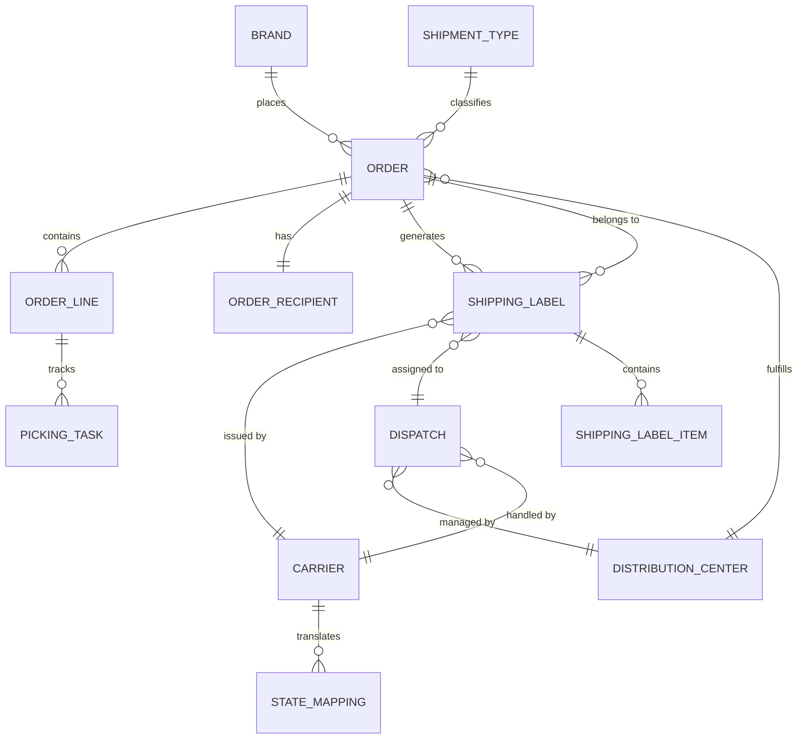

# Data Model and Entity-Relationship Diagram

## Entity-Relationship Diagram (ERD)

The following diagram reflects the approved physical data model for the CargaExpress platform. All implementations must be consistent with this schema.

## Entity catalog

| Entity | Color in diagram | Role |
|---|---|---|
| `CARRIER` | Dark blue | Represents a logistics carrier integrated with the platform. |
| `DISTRIBUTION_CENTER` | Orange | A physical warehouse or dispatch hub managed by CargaExpress. |
| `BRAND` | Purple | A commercial brand that places orders through the platform. |
| `SHIPMENT_TYPE` | Green | Classifies the shipping modality (e.g., express, standard). |
| `ORDER` | Teal | A fulfillment order placed by a brand, assigned to a DC and carrier. |
| `ORDER_LINE` | Dark green | A line item within an order, referencing a specific SKU. |
| `ORDER_RECIPIENT` | Blue | The end-customer receiving the order (1:1 with ORDER). |
| `DISPATCH` | Dark teal | A dispatch event linking a distribution center to a carrier for an order. |
| `SHIPPING_LABEL` | Red | A physical/digital label generated per order and carrier. |
| `SHIPPING_LABEL_ITEM` | Pink | Line-item breakdown within a shipping label. |
| `PICKING_TASK` | Dark green | A warehouse picking task linked to a specific order line. |
| `STATE_MAPPING` | Dark blue | Maps raw carrier status codes to canonical shipment states. |

## Key strategy

- **Natural key:** a business/source identifier that already exists in the relevant domain (e.g., `tracking_number`, `brand_order_ref`). Its uniqueness scope must be explicit — a tracking number is unique **per carrier**, not globally.
- **Global identifier:** an internal surrogate key (`bigint`) used by CargaExpress to correlate records across carriers, systems, and services.
- **Source identity:** every external record retains the `carrier_id` alongside external IDs so that cross-carrier collisions are resolved deterministically.

## Key relationships

## Canonical status field

The `SHIPPING_LABEL.status` field and the `ORDER.status` field must contain only canonical state identifiers as defined in [Canonical Shipment States](../requirements/canonical-states). Valid values are:

| Value | Description |
|---|---|
| `CREATED` | Record created, not yet picked up. |
| `PICKED_UP` | Carrier has collected the shipment. |
| `IN_TRANSIT` | Shipment moving through the carrier network. |
| `OUT_FOR_DELIVERY` | Assigned to last-mile delivery route. |
| `EXCEPTION` | Operational hold or anomaly reported. |
| `DELIVERED` | Successfully delivered — **terminal**. |
| `RETURNED` | Return initiated — **terminal**. |
| `LOST_OR_DAMAGED` | Confirmed loss or damage — **terminal**. |

The raw carrier status is preserved in `STATE_MAPPING.raw_status`. Never discard the source event.

## Order-to-label cardinality

`RN-07` specifies that **one order may have multiple shipping labels** (e.g., multi-package shipments or relabeling after an exception). The model supports a one-to-many `ORDER → SHIPPING_LABEL` relationship. Never use a single label field on the order as the sole label reference.

## Data integrity requirements

- Enforce foreign-key constraints for all relationships shown in the ERD.
- Define `UNIQUE` constraints scoped to the correct domain (`tracking_number` per `carrier_id`).
- Preserve the raw carrier event identity to support idempotent processing and duplicate detection.
- Use versioned migration scripts and fixed-seed, idempotent seed data.
