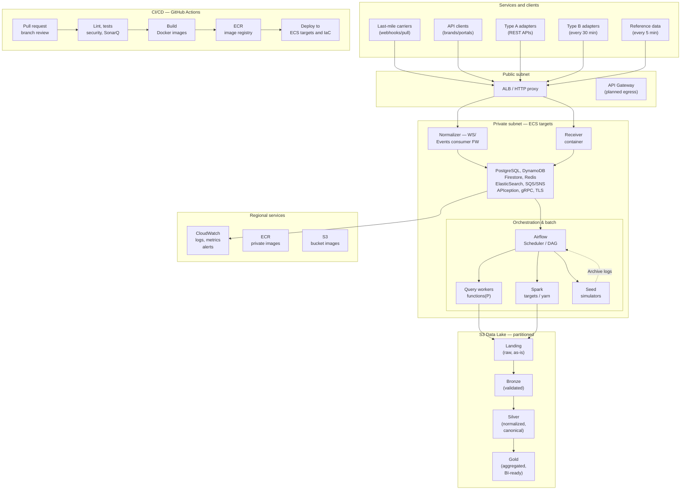

# Architecture Overview

## System architecture diagram

The diagram below shows the full production architecture deployed across two AWS availability zones. It covers the ingestion path, orchestration layer, Data Lake, observability stack, and CI/CD pipeline.

## Architectural goal

The Control Tower must integrate heterogeneous carrier systems while keeping carrier-specific behavior isolated from core shipment rules. The WMS supports warehouse operations; the Control Tower consolidates shipment events and applies common domain rules using a unified set of **canonical shipment states**.

## Component overview

## Logical component responsibilities

| Component | Responsibility | Status |
|---|---|---|
| **ALB / HTTP proxy** | TLS termination, routing, rate limiting | Planned — public subnet |
| **Carrier adapters** | Carrier-specific push/pull/file connectors; isolate parsing from domain logic | Simulator layer complete in Sprint 2 |
| **Receiver container** | Validate and store raw inbound events for full traceability | Target capability |
| **Normalizer** | Map carrier codes to canonical states; reject invalid transitions | Required by RN-01, RN-02 |
| **Domain/rules layer** | Enforce state transition rules; SLA/risk evaluation | Backlog-driven; full RN validation required |
| **PostgreSQL** | Transactional store for orders, labels, mappings, canonical states | ERD defined — see Data Model |
| **DynamoDB / Firestore** | High-velocity event log and carrier-specific raw event store | Simulated in Sprint 2 Type B |
| **Redis** | Session, idempotency keys, and short-lived caching | Planned |
| **S3 Data Lake** | Four-zone Medallion architecture (Landing → Bronze → Silver → Gold) | Planned for Sprint 3 |
| **Airflow** | Orchestrate batch ingestion DAGs, polling schedules, and Spark jobs | Sprint 3 scope |
| **Spark** | Distributed transformation for large-volume carrier file ingestion | Sprint 3 scope |
| **CloudWatch** | Logs, metrics, dashboards, and alerts | Regional observability target |
| **ECR + GitHub Actions** | Container image registry and full CI/CD pipeline | Sprint 3 delivery target |

## Data-ingestion patterns

| Pattern | Description | Canonical path |
|---|---|---|
| **Push** | Carrier sends a webhook event to the ALB endpoint | Carrier → ALB → Receiver → Normalizer → DB |
| **Pull (Type A)** | CargaExpress queries a REST carrier API per tracking number | Airflow DAG → Query Worker → Carrier API → Normalizer |
| **Pull (Type B)** | Scheduled batch poll every 30 min to a heterogeneous carrier DB | Airflow DAG → Spark → Carrier DB → Landing zone |
| **File** | Carrier supplies a batch file; validated and imported via Spark | S3 Landing → Spark → Bronze → Silver |

## Canonical shipment states

All services and components **must use** the following canonical identifiers when referencing shipment status. See [Canonical Shipment States](../requirements/canonical-states) for the full state machine and transition rules.

| State | Meaning | Terminal |
|---|---|:---:|
| `CREATED` | Order created | |
| `PICKED_UP` | Carrier collected | |
| `IN_TRANSIT` | Moving through network | |
| `OUT_FOR_DELIVERY` | Last-mile assignment | |
| `EXCEPTION` | Operational hold / anomaly | |
| `DELIVERED` | Successfully delivered | ✓ |
| `RETURNED` | Return initiated | ✓ |
| `LOST_OR_DAMAGED` | Confirmed loss or damage | ✓ |

## Recommended module boundaries

1. **API and interface layer:** HTTP endpoints, authentication, request validation, and health checks.
2. **Integration layer:** carrier-specific adapters, polling schedule, file parsing, retry/error handling, and source contracts.
3. **Application layer:** orchestration of ingestion and business use cases.
4. **Domain layer:** canonical states, transition rules, SLA/risk policies, and order/label relationships.
5. **Persistence layer:** repositories, database models, migrations, seed scripts, and transaction boundaries.
6. **Operations layer:** logging, health checks, configuration, containerization, and CI/CD automation.

> [!NOTE]
> These are logical boundaries for design and documentation review, not a claim that every layer is already deployed as a separate service.

## Cross-cutting requirements

- Preserve source traceability — never discard raw carrier events.
- Handle out-of-order events and inconsistent date formats across carriers.
- Use fixed-seed, reproducible, idempotent seed scripts.
- Keep brand, carrier, order, and label relationships consistent with the approved ERD.
- Use explicit, versioned contracts and documented error behavior per adapter.
- Terminal canonical states (`DELIVERED`, `RETURNED`, `LOST_OR_DAMAGED`) must never regress.
