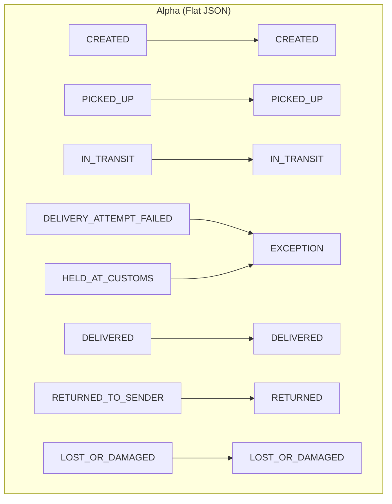

# Type A Webhook Simulator (Push)

Two services that work as a pair for testing real event ingestion without depending on any real carrier or on the backend.

| Service | What it does |
|---|---|
| **Simulator** | Plays the role of 5 carriers. Pushes tracking events over HTTP `POST`, each carrier with its own format and its own statuses, including configurable duplicate and out-of-order events. |
| **Receiver** | An API that receives those webhooks, understands all 5 formats, translates statuses to canonical values, and stores everything in an ACID database. |

> This implements **F3 — Type A carrier webhooks** (user story **HU-17**, RIWI-82).

## The 5 carriers

| Carrier | Message format | Content-Type | Example custom statuses |
|---|---|---|---|
| `alpha` | Flat JSON (snake_case, UTC ISO time) | `application/json` | `IN_TRANSIT`, `HELD_AT_CUSTOMS`, `RETURNED_TO_SENDER` |
| `beta` | Nested JSON (camelCase, numeric code, epoch ms) | `application/json` | `100`, `300`, `600`, `999` |
| `gamma` | Spanish JSON (local time `-05:00`) | `application/json; charset=utf-8` | `En reparto`, `Intento fallido`, `Novedad` |
| `delta` | XML (short codes, compact time) | `application/xml` | `PCK`, `HUB`, `NDL`, `RTS` |
| `epsilon` | Form (`x-www-form-urlencoded`, epoch seconds) | `application/x-www-form-urlencoded` | `Collected from sender`, `Held - address verification` |

Every carrier has **10 or 11 statuses** (the minimum required is 6). All statuses map to the 8 canonical states.

### Carrier status-to-canonical mapping



## Receiver API

| Method | Path | Purpose |
|---|---|---|
| `POST` | `/webhooks/{carrier}` | Ingest one event. `200` stored or duplicate · `404` unknown carrier · `413` too big · `422` unreadable payload |
| `GET` | `/health` | Liveness + database check |
| `GET` | `/stats` | Totals, duplicates, out-of-order, rejected, per-carrier counts |
| `GET` | `/events` | Browse stored events (`carrier`, `tracking_number`, `after_id`, `limit`) |
| `GET` | `/exports/events.ndjson` | Full export, one JSON object per line |
| `GET` | `/exports/events.csv` | Same data as CSV |

Duplicates answer **200 on purpose**: a real carrier keeps retrying on errors, so the receiver acknowledges a repeat and counts it (`delivery_count`).

## Chaos engineering configuration

| Variable | Flag | Default | Description |
|---|---|---|---|
| `SIM_DUPLICATE_RATE` | `--duplicate-rate` | `0.10` | Probability of re-sending an identical event |
| `SIM_OUT_OF_ORDER_RATE` | `--out-of-order-rate` | `0.10` | Probability of an event arriving after a later event |
| `SIM_DUPLICATE_MAX_DELAY` | `--duplicate-max-delay` | `5` | A duplicate arrives at most N messages later |
| `SIM_RATE` | `--rate` | `5` | Messages per second (`0` = no pauses) |
| `SIM_SHIPMENTS_PER_BATCH` | `--shipments-per-batch` | `20` | Shipments mixed together in each batch |
| `SIM_MAX_EVENTS` | `--max-events` | `0` | Stop after N messages (`0` = run forever) |
| `SIM_SEED` | `--seed` | random | Replays the exact same simulation |

## Running with Docker

```bash
docker compose up --build          # receiver + simulator, running continuously
```

```bash
curl localhost:9000/stats                                # what has arrived so far
curl 'localhost:9000/events?carrier=delta&limit=3'       # peek at some stored events
docker compose logs -f simulator                         # what is being sent
docker compose run --rm tests                            # lint (ruff) + the whole test suite
```

## How events are generated

1. Each shipment follows a life cycle (normal, with exception, return, loss, or cancellation). At every step one of the carrier's own statuses is picked at random. Timestamps inside a shipment are always chronological.
2. Shipments of a batch are shuffled together.
3. **Out of order:** with probability `out_of_order_rate`, an event swaps places with a later event of the same shipment.
4. **Duplicates:** with probability `duplicate_rate`, the exact same message (same id, same bytes) is re-sent.

## Project structure

```text
webhook_simulator/
├── domain/       catalog.py · models.py · generator.py · chaos.py
│                 → pure logic, no I/O
├── formats/      encoders.py (what carriers send) · decoders.py (what the receiver reads)
├── simulator/    config.py · sender.py · runner.py · stats.py · cli.py
└── receiver/     config.py · api.py · service.py · repository.py · db.py · schemas.py
tests/            one test file per module + test_end_to_end.py
```

## Verification results

- **69 automated tests pass**, including a cross-check that Alpha/Beta/Gamma statuses exist in the backend's `state_mapping` migration `c4a1209b7e6f`.
- **Mutation testing:** 7 intentional code breakages all detected by the test suite.
- **Real execution outside pytest:** 300 messages to a receiver, 33 duplicates detected, XML and form formats verified.
