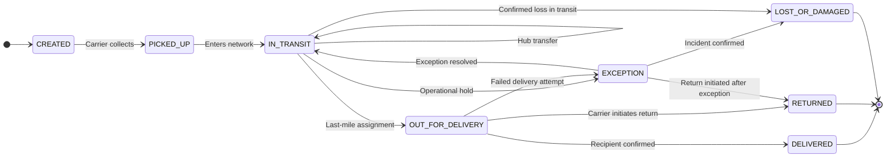

# Problem Statement and Goals

## The problem

CargaExpress operates as a third-party logistics (3PL) company connecting **60 brands**, **9 distribution centers**, and **12 carriers**. Each carrier reports shipment progress differently: different status names, numeric codes, date formats, event ordering, and API contracts.

Without a canonical model the team cannot:

- Compare shipment progress across carriers.
- Identify delayed orders in real time.
- Explain exceptions consistently.
- Calculate business rules (SLA, penalties, responsibility) with a single set of logic.
- Produce reliable data for settlement and financial processes.

## Project goals

| Goal | Description |
|---|---|
| **Unified visibility** | Translate every carrier's proprietary statuses into 8 canonical shipment states so all shipments can be compared. |
| **Traceable normalization** | Preserve raw carrier events and maintain full traceability from the original event to the normalized canonical state. |
| **Transition protection** | Apply controlled state-transition rules and detect anomalous or out-of-order events. Terminal states must never regress. |
| **SLA and risk** | Calculate delivery deadlines in business days, identify at-risk orders, and attribute responsibility (distribution center, carrier, or brand). |
| **WMS integration** | Support warehouse workflows: orders, shipping labels, picking, fulfillment, and dispatch. One order may have multiple shipping labels. |
| **Multi-modal ingestion** | Ingest carrier data through three modalities: push (webhooks), pull (REST API polling), and file-based (CSV/XLSX batch). |
| **Operational analytics** | Prepare reliable data for operational reporting, carrier compliance monitoring, and periodic billing or settlement processes. |

## The 8 canonical statuses

The entire system normalizes carrier-specific events into these canonical identifiers:

| Canonical status | Meaning | Terminal |
|---|---|:---:|
| `CREATED` | Shipment registered in the system | |
| `PICKED_UP` | Carrier has physically collected the shipment | |
| `IN_TRANSIT` | Moving through the carrier network | |
| `OUT_FOR_DELIVERY` | Assigned to a last-mile delivery route | |
| `EXCEPTION` | Operational hold, failed attempt, or anomaly | |
| `DELIVERED` | Successfully delivered to the recipient | ✓ |
| `RETURNED` | Return initiated, will not be delivered | ✓ |
| `LOST_OR_DAMAGED` | Confirmed lost or damaged, requires claim | ✓ |

## The 12 carriers across 3 integration types

| Type | Modality | Carriers | Mechanism |
|---|---|---|---|
| **Type A — Push** | Webhook | 5 carriers (Alpha, Beta, Gamma, Delta, Epsilon) | Carriers push events via HTTP POST in 5 different formats |
| **Type B — Pull** | REST API | 4 carriers (A, B, C, D) | CargaExpress polls REST APIs every 30 minutes |
| **Type C — File** | Batch file | 3 carriers (TransExpress, Rápido Andino, Logística 360) | CSV/XLSX files processed every 4 hours |

All three modalities converge into the same raw event store and are normalized with the same rules.

## Success criteria

- Every carrier event can be traced from the original source format to the normalized canonical status.
- Terminal states (`DELIVERED`, `RETURNED`, `LOST_OR_DAMAGED`) are irreversible.
- Unknown carrier statuses are surfaced for review, never silently misclassified.
- Out-of-order events do not overwrite more recent canonical states.
- SLA calculations use business days with correct calendar and cut-off rules.
- Seed data is deterministic, reproducible, and idempotent.
