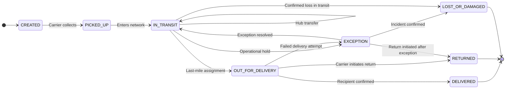

# Canonical Shipment States

The Control Tower uses a canonical state catalog so that carrier-specific labels and codes can be compared consistently across all integrated carriers. These identifiers are the **system of record** for shipment status normalization; all carrier adapters must map to these values and no other.

## Canonical state catalog

| Canonical identifier | Meaning | Terminal state |
|---|---|:---:|
| `CREATED` | Order and shipment record has been created in the system. | |
| `PICKED_UP` | The carrier has physically collected the shipment. | |
| `IN_TRANSIT` | The shipment is moving through the carrier network. | |
| `OUT_FOR_DELIVERY` | The shipment has been assigned to a last-mile delivery route. | |
| `EXCEPTION` | An operational issue, hold, or anomaly has been reported by the carrier. | |
| `DELIVERED` | The shipment has been successfully delivered to the recipient. | ✓ |
| `RETURNED` | The shipment has entered a return process and will not be delivered. | ✓ |
| `LOST_OR_DAMAGED` | The shipment is confirmed lost or damaged and requires a claim process. | ✓ |

## Canonical state machine

## Normalization rules

Each carrier adapter must map the carrier's own status values to exactly one canonical identifier using the `STATE_MAPPING` table. The mapping must be explicit and versioned. Rules:

- **Unknown carrier status:** must be recorded as-is in the raw event log. It must not be silently mapped to a default canonical state. Surface it for operational review.
- **Ambiguous carrier status:** a carrier status that could map to multiple canonical states must have a deterministic priority rule documented in the adapter contract.
- **Case sensitivity:** canonical identifiers are stored and compared in uppercase.

## Final-state protection (RN-02)

Terminal states — `DELIVERED`, `RETURNED`, and `LOST_OR_DAMAGED` — are **irreversible**. Any inbound carrier event that attempts to transition a shipment backward from a terminal state must be:

1. Recorded in the raw event log for traceability.
2. Rejected at the normalization layer — the canonical status must not be updated.
3. Flagged for operational review.

## Required validation cases

- A known carrier status maps to the expected canonical identifier.
- An unknown carrier status is surfaced for review, not silently misclassified.
- An event arriving out of chronological order does not overwrite a more-recent canonical state.
- A transition from a terminal state to any earlier state is rejected and logged.
- The raw carrier status and source event identity remain traceable for troubleshooting.
- Carrier-status mapping coverage is testable via a dedicated test fixture per carrier adapter.
