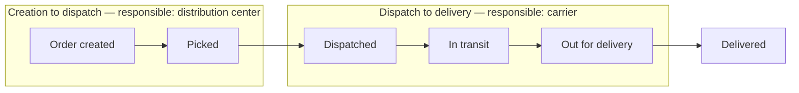
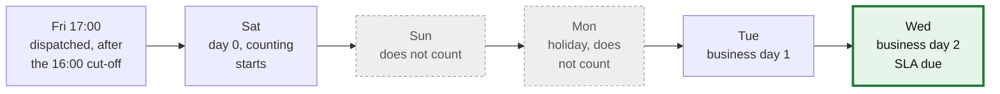

# SLA, Delay, and Responsibility

Part of the data model work of US-04 and of rules RN-03, RN-04, RN-05, and RN-07. This page explains who is responsible at each stage of an order and how the SLA clock runs in business days.

## Who is responsible at each stage

| Stage | Responsible |
|---|---|
| Creation to dispatch | Distribution center (CD) |
| Dispatch to delivery | Carrier |
| An open issue caused by a wrong address | Brand |
| An open issue with any other cause | Carrier |

The SLA clock counts **business days, without Sundays or public holidays of the destination country**.

## Measuring time

| Measure | Formula |
|---|---|
| Distribution center time | dispatch − creation |
| Carrier time | delivery − dispatch |
| Delay | delivery − deadline |

## At-risk orders (RN-04)

An order is at risk when either condition holds:

- **24 business hours or less** remain before the deadline and the order is **not** out for delivery.
- An issue (`EXCEPTION`) has been **open for more than 12 hours**.

## Orders with multiple shipping labels (RN-07)

An order meets the SLA only if **every** shipping label is delivered on time. One late label makes the whole order non-compliant.

## Worked example (acceptance criterion CA-02)

An order is dispatched on **Friday at 17:00**. Its SLA is **2 business days**, and **Monday is a holiday**.

**Result: the deadline is Wednesday.**

| Day | What happens |
|---|---|
| Friday 17:00 | Dispatch happens after the 16:00 cut-off |
| Saturday | Day 0: counting starts on the next business day |
| Sunday | Does not count |
| Monday | Holiday, does not count |
| Tuesday | Business day 1 |
| Wednesday | Business day 2: the SLA is due |

Everything is stored in UTC. The 16:00 cut-off and the holidays are applied using the time zone and the destination country of each order. If the distribution center is in one country and the destination in another, the clock uses the **destination** calendar (RN-03). See ADR-0010 in the Architecture Decisions page.

## Carrier compliance monitoring (RN-09)

A carrier that falls below **85% on-time compliance** for two consecutive half-month periods is placed `UNDER_REVIEW`. A carrier with only one bad period remains `ACTIVO`.

## Penalty attribution (RN-05)

| Condition | Penalty target |
|---|---|
| Carrier delivers after the SLA deadline | Carrier |
| Distribution center takes too long to dispatch | Distribution center |
| Issue caused by wrong address from the brand | Brand (no penalty) |

Penalty tiers (from seed data): 1–2 days late → 5%, 3–5 days late → 10%, 6+ days late → 20%. These values are test defaults; production tiers require approval.

## Fixed scenario orders for testing

The seed data includes controlled orders with the prefix `SCN-` that exercise each business rule:

| Reference | Case |
|---|---|
| `SCN-01` | Normal dispatch, delivered inside the SLA |
| `SCN-02` | Dispatch on Friday at 17:00, after the 16:00 cut-off, with a Monday holiday |
| `SCN-03` | Late delivery, carrier responsible, penalty passed to the carrier |
| `SCN-04` | Dispatch took 54 hours, distribution center responsible |
| `SCN-05` | Wrong-address issue, brand responsible, no penalty |
| `SCN-06` | One order with 2 shipping labels, one on time and one late (RN-07) |
| `SCN-07` | An event arrives after `DELIVERED` (RN-02) |
| `SCN-08` | Dispatched on a Saturday, 14 business hours to the deadline, still in transit: at risk |
| `SCN-09` | Same dates as `SCN-08` but already out for delivery: not at risk |
| `SCN-10` | An issue open for 16 hours: at risk |
| `SCN-11` | Dispatched on a public holiday |
| `SCN-12` | Distribution center in Mexico, destination Peru: the destination calendar is used |
